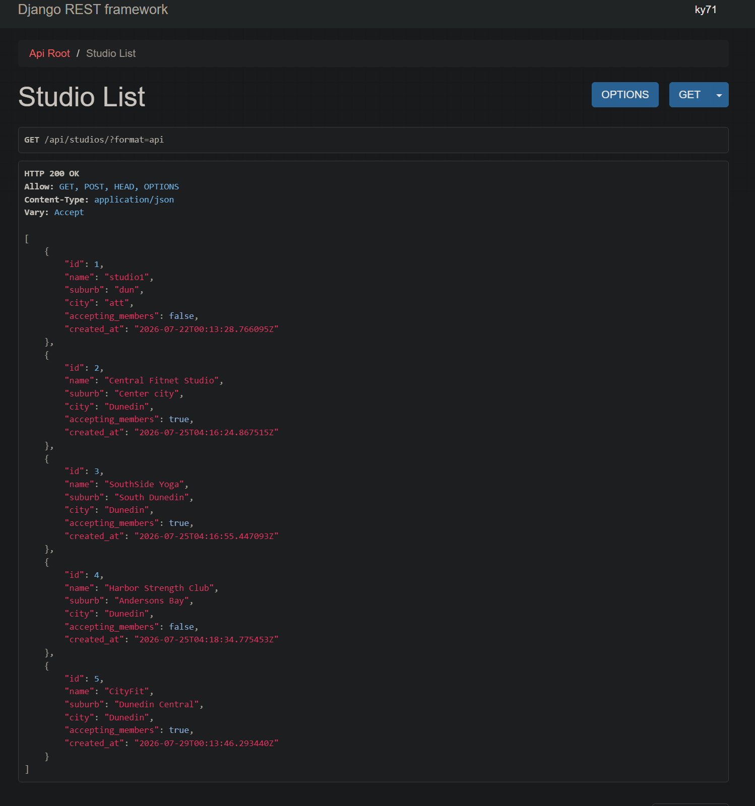
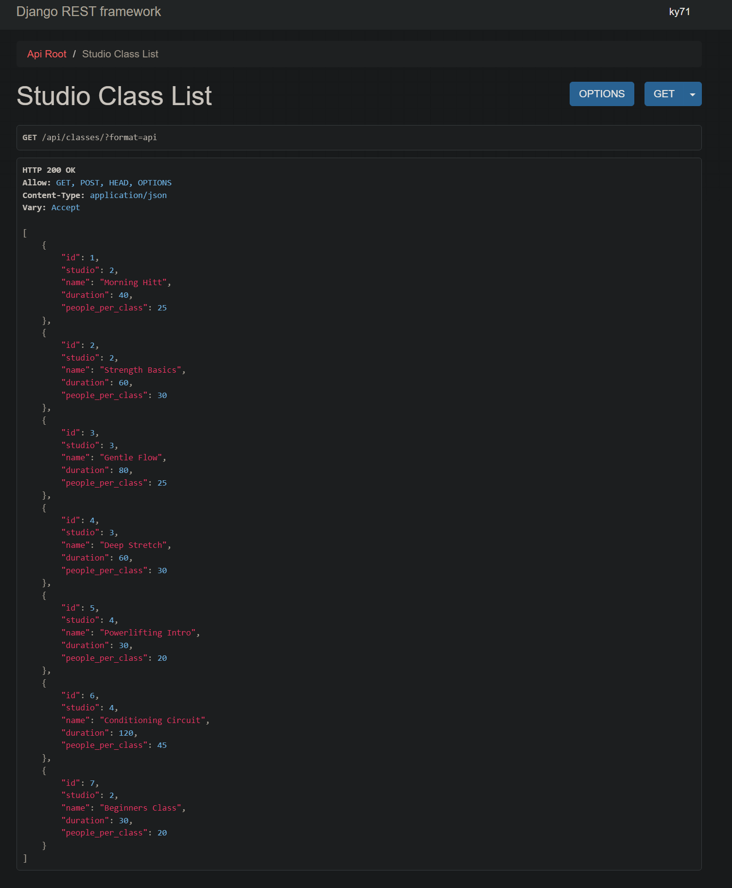
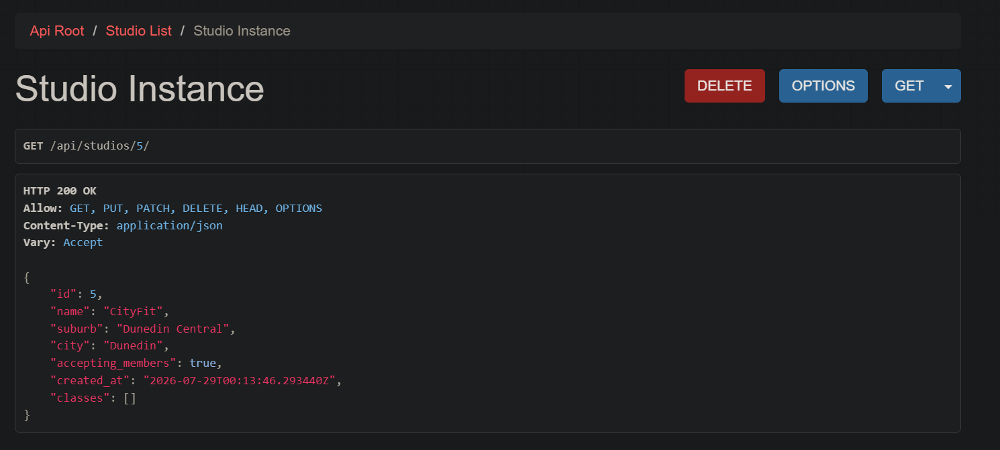
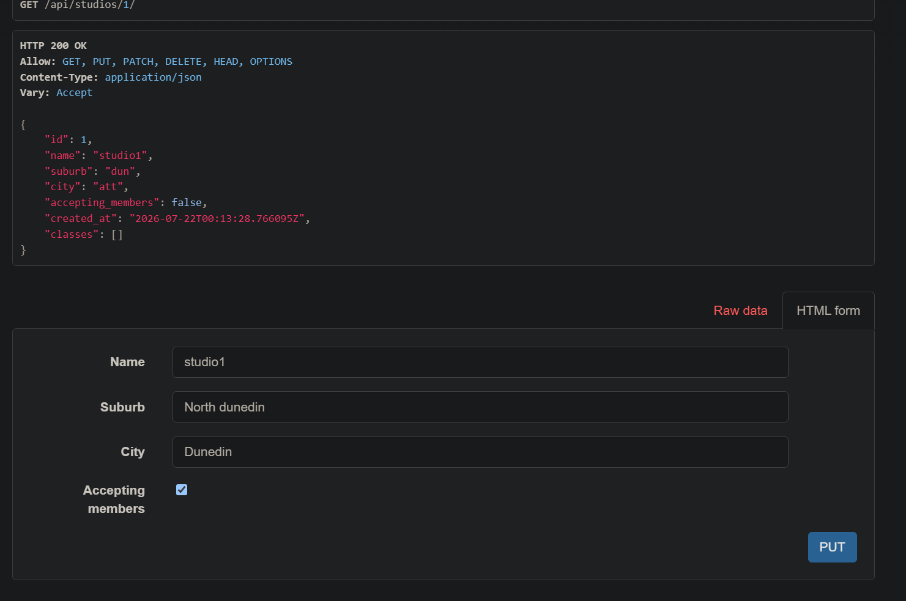
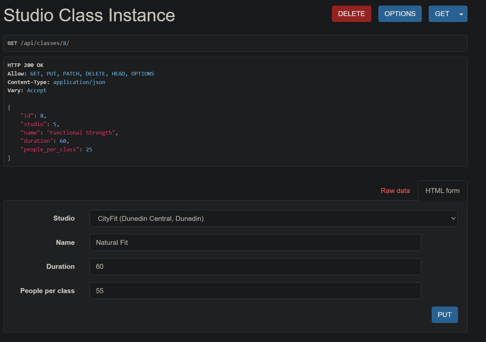
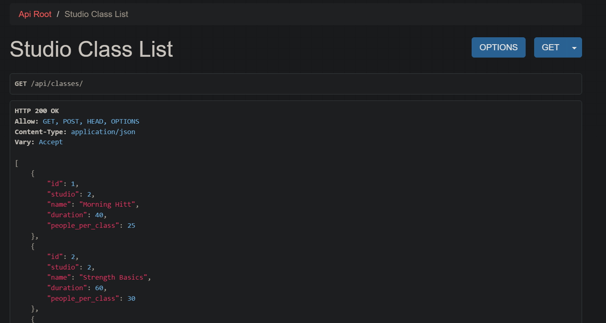
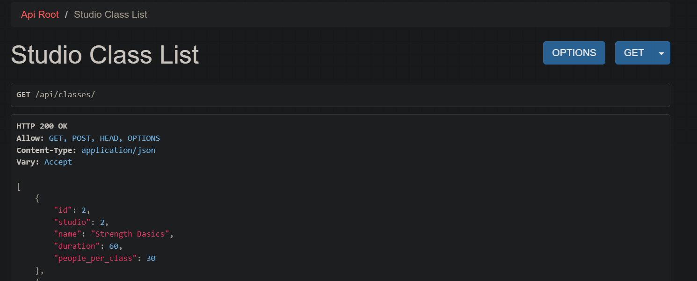

# API Testing

## list

The studios list view 


The Class list view 


## retrieve

Using curl to retrieve a studio by id, separated to make easier to read.
```  
curl http://127.0.0.1:8000/api/studios/2/
{"id":2,"name":"Central Fitnet Studio","suburb":"Center city","city":"Dunedin","accepting_members":true,"created_at":"2026-07-25T04:16:24.867515Z",
"classes":
[{"id":1,"studio":2,"name":"Morning Hitt","duration":40,"people_per_class":25},{"id":2,"studio":2,"name":"Strength Basics","duration":60,"people_per_class":30},

{"id":7,"studio":2,"name":"Beginners Class","duration":30,"people_per_class":20}]}
```

Using curl to retrieve a class by id.
```
curl http://127.0.0.1:8000/api/classes/2/
{"id":2,"studio":2,"name":"Strength Basics","duration":60,"people_per_class":30}
```


## create

Creating a new studio using curl then a screenshot of the created studio.
```
curl -X POST http://127.0.0.1:8000/api/studios/   
-H "Content-Type: application/json"  
-d '{"name": "CityFit", "suburb": "Dunedin Central", "city": "Dunedin"}'
```


Creating a new class using curl and showing the response from the server.

``` 
curl -X POST http://127.0.0.1:8000/api/classes/ \
  -H "Content-Type: application/json" \
  -d '{
    "studio": 5,
    "name": "Functional Strength",
    "duration": 60,
    "people_per_class": 25
  }'
{"id":8,"studio":5,"name":"Functional Strength","duration":60,"people_per_class":25}
```

## update
updating studio1 to have proper suburb and city values.

```
{
    "id": 1,
    "name": "studio1",
    "suburb": "North dunedin",
    "city": "Dunedin",
    "accepting_members": true,
    "created_at": "2026-07-22T00:13:28.766095Z"
}
```

Updating class1 to have a new name and duration.


```
{
    "id": 8,
    "studio": 5,
    "name": "Natural Fit",
    "duration": 60,
    "people_per_class": 55
}
```
## delete

Deleting a studio using curl and showing the response from the server.
```
curl -X DELETE  http://127.0.0.1:8000/api/studios/1/

Result: Studio with id 1 has been deleted successfully.

HTTP 200 OK
Allow: GET, POST, HEAD, OPTIONS
Content-Type: application/json
Vary: Accept

[
    {
        "id": 2,
        "name": "Central Fitnet Studio",
        "suburb": "Center city",
        "city": "Dunedin",
        "accepting_members": true,
        "created_at": "2026-07-25T04:16:24.867515Z"
    },
    {
        "id": 3,
        "name": "SouthSide Yoga",
        "suburb": "South Dunedin",
        "city": "Dunedin",
        "accepting_members": true,
        "created_at": "2026-07-25T04:16:55.447093Z"
    },
    {
        "id": 4,
        "name": "Harbor Strength Club",
        "suburb": "Andersons Bay",
        "city": "Dunedin",
        "accepting_members": false,
        "created_at": "2026-07-25T04:18:34.775453Z"
    },
    {
        "id": 5,
        "name": "CityFit",
        "suburb": "Dunedin Central",
        "city": "Dunedin",
        "accepting_members": true,
        "created_at": "2026-07-29T00:13:46.293440Z"
    }
]
```

Class deletion using DRF's browseable API and showing the response from the server.

Before pressing the delete button on Morning Hitt, the class list view is shown below.


the classes after Morning Hitt has been deleted is shown below.



## Task 4 Query parameters

The function to filter studios by city.

```
def get_queryset(self): 
        if self.request.query_params.get("city"):
            return self.queryset.filter(city__iexact=self.request.query_params.get("city")) # filter studios by city, case-insensitive with fieldName__iexact
        return self.queryset

```

The curl command to filter studios by city.

```
curl http://127.0.0.1:8000/api/studios/?city=BALCLUTHA

[{"id":6,"name":"Clutha Fit","suburb":"Clutha","city":"Balclutha","accepting_members":true,"created_at":"2026-07-29T01:21:55.929744Z"}]
```