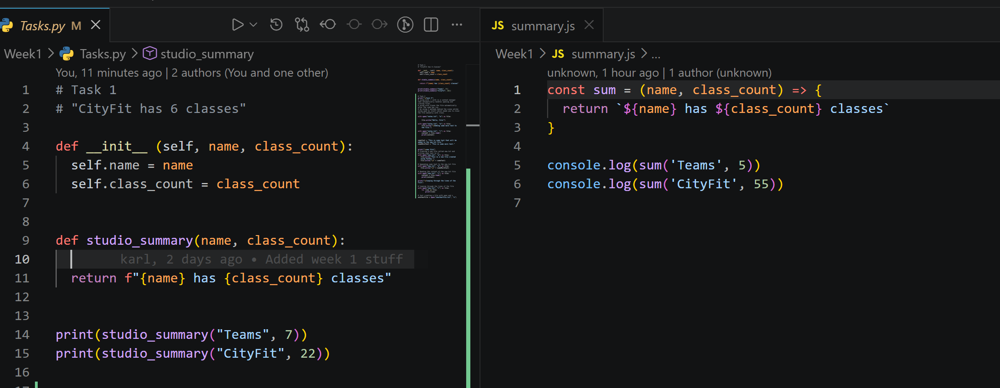
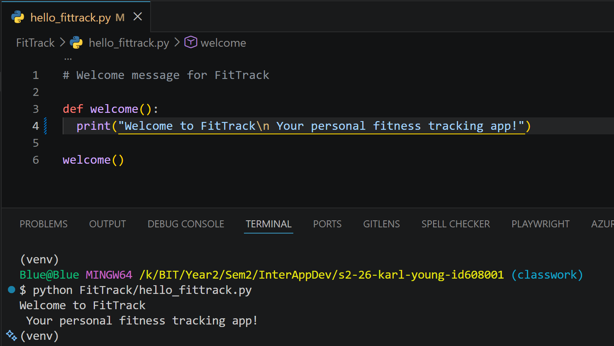
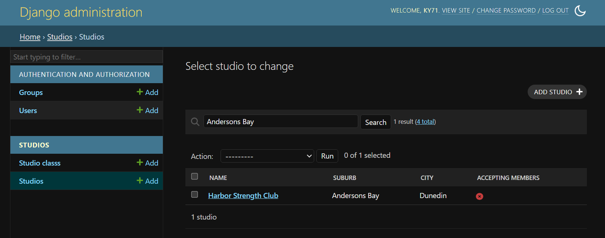

Karl Young - karl-young

**Task 1**
A screenshot of the summary functions.



---

**Task 2**
A video of the with Context manager
The code for the video:
```
# Task 2
print("\nTask 2")
# using with -- with is a context manager that automatically handles opening and closing files.
# using with closes the file automatically after the code has run.
# by using 2 methods behind the scene unlike using open by itself which needs you to close the file manually with close.

with open("notes.txt", "w") as file:
    
    file.write("Hello, file!")

with open("notes.txt", "a") as file:
    file.write("\nAdding some more text to the file.")

with open("notes.txt", "r") as file:
    content = file.read()
    print(content)


someText = "This is some text that will be added to the new.txt file."
someMoreText = "This is some more text."


print("\nnew file")
# Creating a new file called new.txt and writing some text to it
with open("new.txt", "w") as file:
   file.write("This is a new file created using Python.")
   file.write("\n" + someText)

# Appending some text to the new.txt file
with open("new.txt", "a") as file:
   file.write("\n" + someMoreText)

# Reading the content of the new.txt file
with open("new.txt", "r") as file:
    content = file.read()
    print(content)

print("\nlooping through the lines of the file")

# looping through the lines of the file
with open("new.txt", "r") as file:
    for line in file:
        print(line)
```

[Link to the video](https://www.youtube.com/watch?v=NS7Ruf9UTPs)

---

**Task 3**

A screenshot of the welcome function and the output in the console with venv.


---

**Module 2**

**Task 3**
The question was how many studios are there in andersons bay

I opened the Django admin and when to the studio section. then used the search bar to search for Andersons Bay which worked because i added the studio_suburb to the search_fields in my ClassAdmin. 
The admin search filtered the list and only showed the classes with the studio in Andersons Bay.



---

**Task 4**

I added total_classes to the list_display to make it easier to see which studios have many classes or none. this improves the admin experience by being able to see straight away which studios have many classes and which might need some more classes added. 

I chose this option over ordering and inline editing because a computed column makes the admin page more informative at a glance. it provides more information directly in the list view making it easier to see the data without needing to open each studio one by one.

Adding 250 more extra to studioClassInline makes adding data awkward as if your an admin and need to add 1 for different studios you would need to scroll through 250 extra forms to add one class. 
this would make the admin experience worse as it would be more time consuming to add classes to different studios.
one is much better as you can add one then another empty form will appear for you to add another class which is much more efficient and user friendly.


## Module 6

### Task 6

React Navigation forces you to configure some things manually like defining the navigators, making screens and having to change the screen with code. you have to create the whole navigation file system yourself. 
While the Expo router had been making it so you can just add another component to the apps screen function in index or just in the app folder.  

## Module 7 

### Task 3

I added a rule for the permissions on Studio Classes which blocks deletion if there are active bookings called - BlockDeletionIfBooked. I used the has_object_permission Hook because the rule depends on checking the booking count and the has_permission hook wouldn't be a good fit as i needed to access the object.

I had to add bookings to the studio classes and then try to delete one with the curl command below.
 
```
$ curl -i -X DELETE http://127.0.0.1:8000/api/classes/10/ \
  -H "Authorization: Bearer $SUPER"
HTTP/1.1 403 Forbidden
Date: Sat, 22 Aug 2026 23:26:49 GMT
Server: WSGIServer/0.2 CPython/3.14.6
Content-Type: application/json
Vary: Accept
Allow: GET, PUT, PATCH, DELETE, HEAD, OPTIONS
X-Frame-Options: DENY
Content-Length: 49
X-Content-Type-Options: nosniff
Referrer-Policy: same-origin
Cross-Origin-Opener-Policy: same-origin

{"detail":"Cannot delete classes with bookings!"}(venv) 
```

This curl command deleted the class. 
```
 curl -i -X DELETE http://127.0.0.1:8000/api/classes/8/   -H "Authorization: Bearer
 $SUPER"
HTTP/1.1 204 No Content
Date: Sat, 22 Aug 2026 23:36:44 GMT
Server: WSGIServer/0.2 CPython/3.14.6
Vary: Accept
Allow: GET, PUT, PATCH, DELETE, HEAD, OPTIONS
X-Frame-Options: DENY
Content-Length: 0
X-Content-Type-Options: nosniff
Referrer-Policy: same-origin
Cross-Origin-Opener-Policy: same-origin
```

### Task 6

I implemented the refresh on 401 strategy. which when the api returns with a 401 response the app will automatically changes the refresh token for a new one and retry's the request.

The user will not notice when this happens as the app will stay logged in. 

compared clearing the token and sending the user back to the login page every 5 minutes. this is a better user experience and will show no interruption to the user. 
but might be slightly slower on the first request as the app will handle a failed request and then retry it with a new token. but this is still better than logging the user out every 5 minutes.