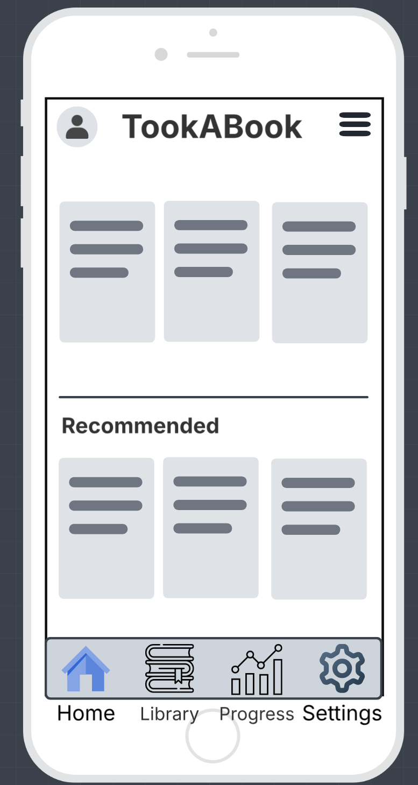
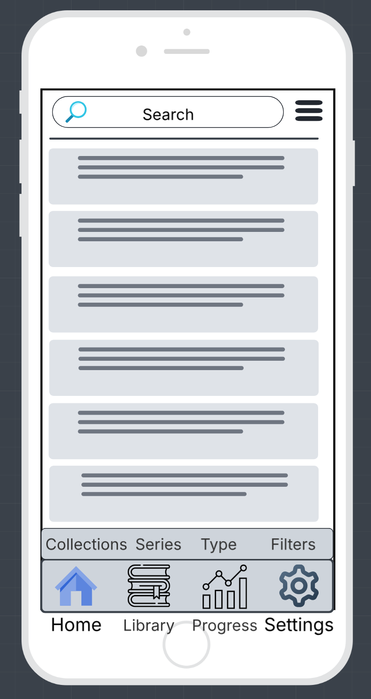
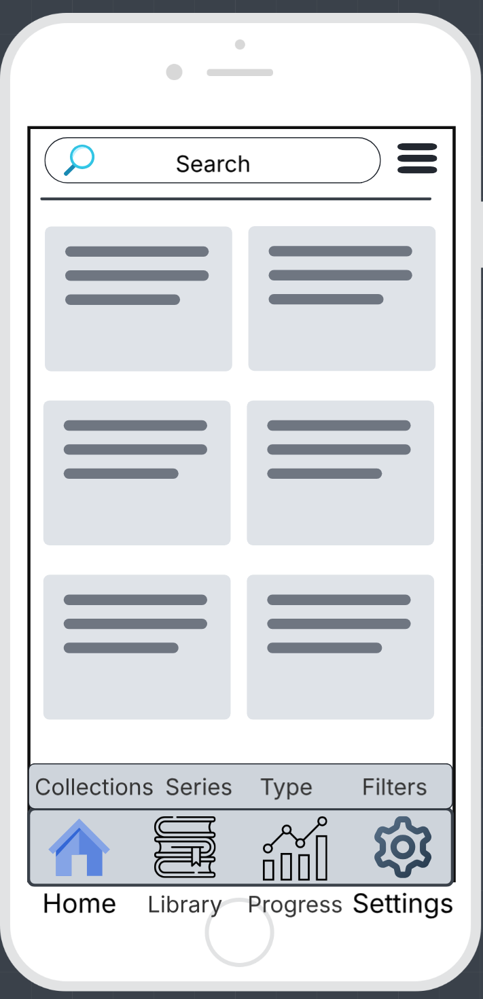
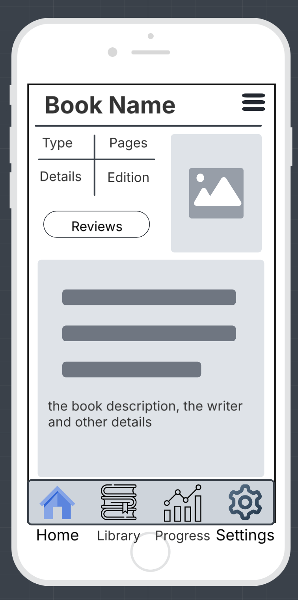
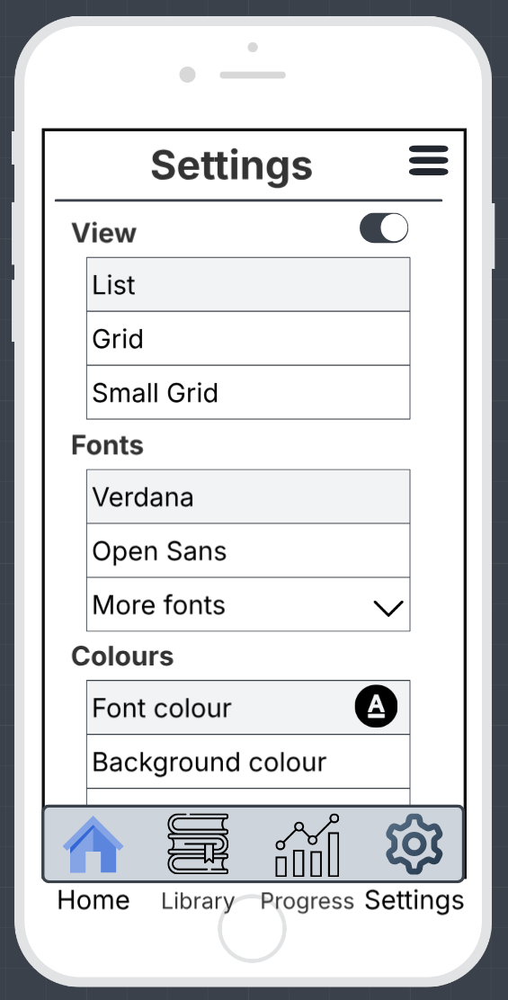
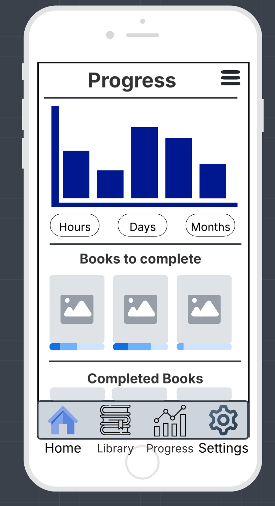
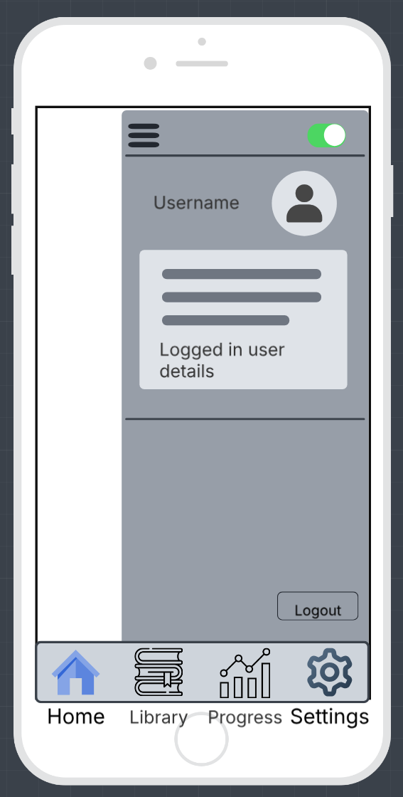
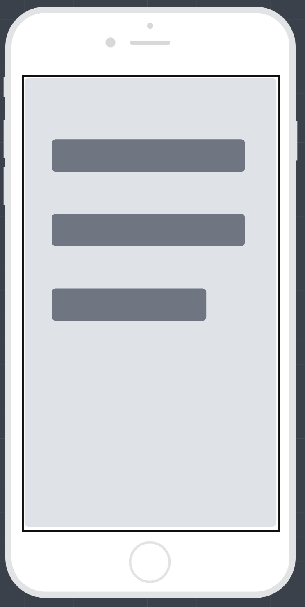
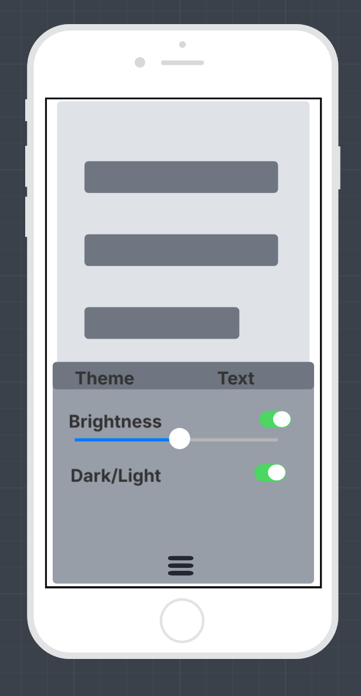
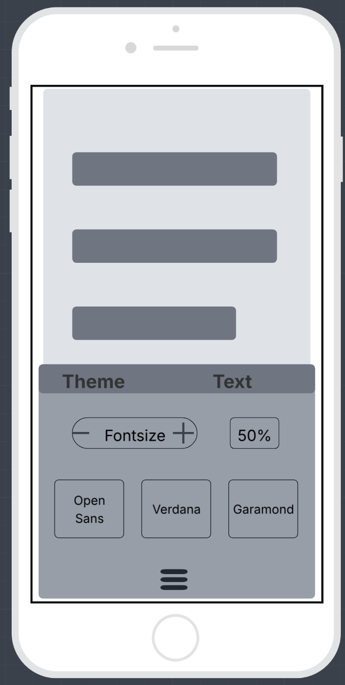

## Mobile App Idea
Choose an idea for a mobile app that solves a problem, helps people complete a task, or provides entertainment. Your app can be for any audience and any purpose.
In addition, provide the following:

 - App Name
 - Purpose - In 2-3 sentences, explain what your app does and who it is for.
 - Target Audience - Who will use your app?
 - Core Features - List 4-6 key features your app will include.
 - Screen Designs - Sketch or wireframe at least 5 screens (paper, Figma, or another design tool). 
 - Navigation - Show how users move between screens.
 - Design Choices - Briefly explain your colour scheme, fonts, icons, and overall style.
 

## TookABook

---

## Purpose 
This app is a place to store all your ebooks, audiobooks and view PDFs.
It can help you keep track of your reading progress, and recommend books based on your reading history. You can upload your own books by copying them to the app. 
This app works for anyone it is user friendly. 
It can be a tool to help you with school projects, research, storing information and entertainment.

---

## Target Audience
 Students, audio book listeners, and anyone who wants to keep track of their reading and listening progress in one place.

---

## Core Features 
- Store ebooks, audiobooks and PDFs.
- Read and listen to books.
- Keep track of reading and listening progress.
- Recommend books based on reading history.
- Upload your own books to save in the app.
- Accessibility features for visually impaired users, such as adjustable fonts / sizes, colours/themes, volume controls and screen reader support.

## Additional possible features
- Connect with other readers and share book recommendations.
- Gamification features like points or badges for chapters or books completed.
- Graphs and statistics to track reading habits and progress over time.
- A welcome page in a book style something with gold embellishment that turns the page to the main screen or login.
- Loading screen with a bookelf or something stealing books and dropping them as it runs across the screen.

### Font options

- Users can change the font in the settings.
- Verdana, Open Sans, Garamond, Display typeface etc.
- Font size and colour can be changed. 

---

## Screen Designs & Navigation

### Home Screen
Users can scroll to the left and right to see the books they have stored in the app
and recommendations on the home screen.

### Library Screen
Users can scroll down to see the books they own in list view and grid view, and search for books their books by title, author or genre.

### Book Details Screen
The book details screen will show the book cover, type, pages, title, author, genre, and a brief description of the book.

### Settings Screen
A downward scrollable settings screen with dropdowns for extra settings, and a toggle for dark mode.

### Progress Screen
In this screen users can view their reading habits and progress over time.
and also scroll down through the completed books and see the progress of each book still being read.

### Sidebar

a side bar that pops out to show user profile dark-mode toggle and logout button.

### Book Reading screen
The main screen to read all of the books in the app. 

Users will be able to scroll down or to the side depending on the book type.
If unfocused on the book eg tap once a menu will show at the bottom with a settings button to change the font, size, colour, and background colour.

Reader settings screen 

Text settings screen

---

## Design Choices 

It will be in dark mode by default, with a toggle to change it in the settings. 
The fonts will be accessible and easy to read, with colour options, to change for accessibility. 
The icons and overall style will be simple relaxed and easy to use. 

---
